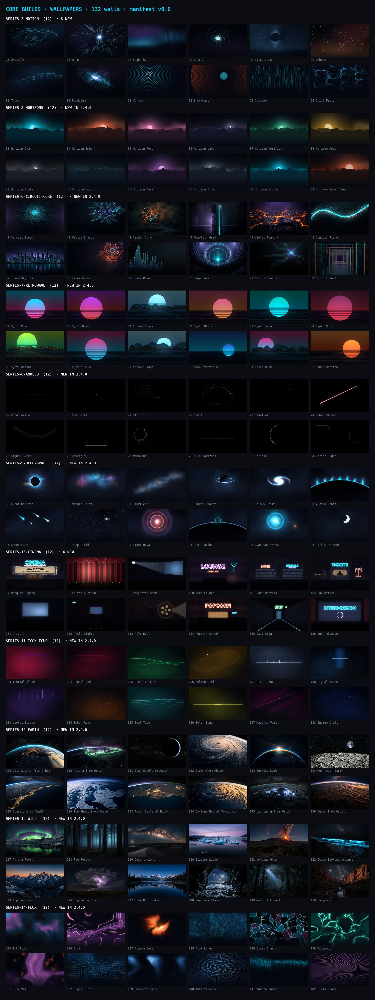

# Core Builds — Wallpaper Collection v6.0

132 wallpapers · 3840×2160 (series 2–3, 7–11, 14) and 1376×768 (series 6, 12–13) ·
Core Builds palette, icon-echo retuned (2026-10-11):
Core Cyan #00d4ff (the icon pack's own Signal cyan) · Glow #7eeeff ·
Build Blue #4facfe · Dusk Violet #9754a8 (nudged toward the icon violet
family) · Ember #d2482a (nudged toward the icon coral family) ·
Night #0d1117 · Void #04070f.

`manifest.json` indexes every wallpaper with a raw GitHub `url`, a bundled
`thumb` URL, its `series`, and `resolution`. Both the repo's README and the
in-app browser read this same file — there is one source of truth.

`manifest.json` is the Core Builds Icon Pack's collection. Rationale
and the wallpaper research behind earlier series is in
[`docs/research/wallpaper-directions.md`](../docs/research/wallpaper-directions.md).

## Series

[](../docs/wallpapers-collection.jpg)

*All 132 walls in manifest order (`tools/build_wallpaper_collection_sheet.py`, rebuilt from the shipped thumbs). The in-app browser's **New** chip lists the walls stamped `since: 2.4.0` — the new series and additions plus every refreshed series. The live loops are a set of their own in the browser (the **Live** chip; see [Motion/live](../Motion/live/README.md)).*

| Series | # | Theme |
|---|---|---|
| `series-0-originals` | (not in manifest) | The original 20 JPGs, kept for history |
| `series-1-fieldwork` | (retired 2.4.0) | Was 24 mesh-gradient washes, 01–24. Retired in 2.4.0 on user feedback ("blurs"); the numbers stay empty, as 4 and 5 do. |
| `series-2-motion` | 25–32, 51–54 | Long-exposure kinetics: orbitals, warp, fogbanks, spiral, slipstream, embers, tracer, pendulum, vortex, shockwave, cascade, drift field. **Refreshed in 2.4.0:** 25–32 are re-authored as light rather than line — hot cores in wide glows, bright heads, depth, a calm lower third — by `tools/build_motion_wallpapers.py` ([contact sheet](../docs/motion-wallpapers.png)); 51–54 come from `tools/build_classic_wallpapers.py`. Since 2.4.0 all twelve also ship as live loops (32–43): the stills themselves given time by `tools/build_still_loops.py`. |
| `series-3-horizons` | 33–40, 55–58 | One horizon, twelve meanings — the §03 semantic accent slots as landscapes. **Refreshed in 2.4.0:** each wall is now a scene — graded sky, sun or moon with its own atmosphere, cloud bands, a thinning star field and three to five ridgelines of fBm terrain stepping into haze — keeping its number, name and accent (`tools/build_horizons_wallpapers.py`, [contact sheet](../docs/horizons-wallpapers.png)). |
| `series-5-pop` | (retired with Pop) | Was Core Builds Pop's 12-wall set, indexed by `pop-manifest.json`. Removed with the pack in 2026-09; the number stays empty so history keeps its meaning. |
| `series-6-circuit-core` | 41–50, 79–80 | **Circuit Core.** Twelve lit-circuit fields on near-black — cyan first, violet/ember ambient — authored at 1376×768 rather than 4K. **Refreshed in 2.4.0:** walls 41–50 are new renders of the same twelve ideas as one coherent set — each a single subject (a blooming core, a monolith, a foundry, a conduit, a skyline of components, a shaft) with depth and a calm lower third, in place of the earlier centred clusters; 79–80 follow. Replaced `series-4-core-mark` in v1.8.6; `tools/build_circuit_wallpaper_extensions.py` reproduces the final pair. |
| `series-7-retrowave` | 59–68, 81–82 | **Retrowave.** **Refreshed in 2.4.0** (same walls, seeds and palettes): the sun blooms, a haze band sits on the horizon, the sun reflects down the grid, the grid emerges from fog, and ridge walls gain a far ridge in haze. Twelve 4K walls in 2026's nostalgic retro-gradient genre: sliced gradient suns, perspective grids, chrome ridges and starfields on the night ground, per `tools/build_synthwave_wallpapers.py`. |
| `series-8-amoled` | 69–78, 83–84 | **AMOLED.** Twelve minimalist 4K walls on exact `#000000`: sparse cyan, violet, and ember geometry with 94–98% true-black coverage; refreshed in 2.4.0 with two-stage halos and hot cores so each stroke reads as emitted light. `tools/build_amoled_wallpapers.py` asserts the ≥50% contract and writes the [contact sheet](../docs/amoled-wallpapers.png). |
| `series-9-deep-space` | 85–96 | **Deep Space.** Twelve 4K space walls in the house palette — event horizon, nebulae, ringed planet, spiral galaxy, comets, novae — all procedural and seeded (`tools/build_deep_space_wallpapers.py`, [contact sheet](../docs/deep-space-wallpapers.png)). **Refreshed in 2.4.0:** every large glow is shaped by ridged fBm noise, so nebulae break into filaments and dust lanes, planet discs carry bands and grain, and a dense faint dust field sits under the stars — same walls, same seeds, more in them. Smooth gradients still ship grain-free: the full-frame dither cost ~9 MB per PNG for a texture invisible at TV distance. |
| `series-10-cinema` | 97–102, 151–156 | **Cinema.** Twelve 4K night-time cinema scenes in neon and marquee light — marquee frontage, velvet stage, projector beam, neon lounge, late-night rentals, box office, then (2.4.0) a drive-in, the aisle lights, a film reel in the booth, the popcorn stand, an exit sign and an intermission screen. Each is drawn once as layers and animated by weighting them, so every wall has a seamless 60 fps loop that is the same drawing (`tools/build_cinema_wallpapers.py`, [contact sheet](../docs/cinema-wallpapers.png)). |
| `series-11-icon-echo` | 103–108, 133–138 | **Icon Echo.** The companion series the [2026-10 concept study](../docs/research/icon-wallpaper-palette-study-2026-10.md) pointed at: each wall is lit by one accent taken straight from the icon catalogue — HeatLive `#EB1E54`, YouTube `#FF0033`, Spotify `#1ED760`, MaxPlayer `#F8A000`, TiviMate `#97C1FF`, ARD `#2D92FF` — and shifted a step toward the night ground (`wall_tones` in `tools/build_icon_echo_wallpapers.py`: deep wash, main light, bright core), so a wall and the icons it backs glow the same colour a shade apart. Palette cues only: no logos, no icon geometry. Six more in 2.4.0 (133–138): Twitch `#9146FF`, Crunchyroll `#FF5E00`, ABC iview `#20B8B8`, Pluto TV `#FFF200`, Binge `#B80472`, Disney+ `#113CCF`. **Relit in 2.4.0:** same compositions and accents, heavier line weight and a two-stage bloom with a deep-tone room and vignette, so the walls read at TV distance. Every Icon Echo wall also ships as a live loop (`tools/build_still_loops.py`, `Motion/live/`). [Contact sheet](../docs/icon-echo-wallpapers.png). |

| `series-12-earth` | 109–116, 143–146 | **Earth.** Twelve walls of the planet from orbit — city lights, aurora from above, a crescent, a storm, an orbital sunrise, Earth over the Moon, a coastline at night, an ice sheet, a river delta at night, a cyclone eye on the terminator, lightning from orbit, dunes from orbit. Generated imagery (AI, prompted for dark frames with a calm lower third), shipped as 1376×768 JPEG at the resolution it was made — the same honesty rule as Circuit Core; not procedural and not reproducible from a tool. |
| `series-13-wild` | 117–124, 147–150 | **Wild.** Twelve nature and landscape-photography walls (aurora over a fjord, a forest in fog, a desert night, a glacier lagoon, a blue-hour lake, a sea cave under stars …), generated the same way as Earth, 1376×768 JPEG. |
| `series-14-flux` | 125–132, 139–142 | **Flux.** Twelve 4K abstract walls — domain-warped ink, folded silk, a plasma core, streamlines, glass facets, caustics, a veil, a bent grid, then (2.4.0) smoke columns, interference rings, an aurora sheet and combed field lines — in the house palette, all procedural and seeded (`tools/build_flux_wallpapers.py`, [contact sheet](../docs/flux-wallpapers.png)). |

Retired: `series-4-core-mark` (41–70, 30 × 4K PNGs of the lit hex + faceted core
diamond) shipped in v1.7.0 and was removed in v1.8.6. Series index 4 stays empty,
5 belonged to Pop (retired 2026-09), and 1 (Fieldwork) was retired in 2.4.0;
subsequent additions continue at series 7 and beyond, currently through
series 14.

## In-app browser

The icon-pack app ships a built-in Wallpapers screen:

- **Thumbs are bundled** (`app/src/main/assets/wallpapers_thumbs/`, about 1 MB for
  all 102) so the grid is instant and works offline.
- **Full images download on demand** from the raw URLs below and are cached in
  internal storage (12-file LRU, ~30 MB ceiling) — the APK stays small. Series 1–3
  and 7–8 are 4K PNG, series 6 is 1376×768 JPEG; `resolution` per entry is the truth.
- **Set** writes the system wallpaper via `WallpaperManager` for launchers
  that theme from it. On Fire TV — which blocks third-party wallpaper writes —
  the image is saved to `Pictures/CoreBuilds` and handed to the system
  crop/setter.
- **Send to Monet** replaces Set when Monet Launcher is HOME. Monet does not
  read the system wallpaper at all; the cached file is shared straight into
  Monet's `WallpaperShareActivity`, which copies it into Monet's own background
  library and themes from it. Requires Monet 1.0.72+ and Monet Premium (Monet
  says so itself if not). See `docs/MONET_LAUNCHER.md`.

## Adding a wallpaper

1. Drop `corebuilds-NN-slug.png` into the right `series-N-name/`, at whatever
   size the art actually is. Do not upscale a smaller source to claim 4K —
   `tests/test_wallpapers.py` decodes the file and compares it with the
   `resolution` you write in step 3.
2. Add a 480×270 JPG thumb to `thumbs/` (centre-crop to 16:9 first, keep it well
   under 60 KB — that byte budget is asserted too).
3. Append an entry to `manifest.json`:
   ```json
   {
     "name": "NN Slug Title",
     "series": "series-N-name",
     "url": "https://raw.githubusercontent.com/brevityA/CoreBuildsApps/main/Wallpapers/series-N-name/corebuilds-NN-slug.png",
     "thumb": "https://raw.githubusercontent.com/brevityA/CoreBuildsApps/main/Wallpapers/thumbs/corebuilds-NN-slug.jpg",
     "resolution": "3840x2160",
     "since": "2.5.0"
   }
   ```
   `since` is the app release the wall first ships in. The browser's **New**
   chip shows the walls whose `since` is the newest in the manifest, so stamp
   every wall of a release with the same version and leave older walls
   untouched; a refreshed wall (new render, same number) gets the new version.
4. Run `python tools/sync_wallpaper_manifest.py`. It verifies every manifest
   entry against the files on disk, copies the manifest into
   `app/src/main/assets/manifest/wallpapers.json`, and keeps the bundled
   thumb set exactly the manifest's set — it removes stale thumbs and adds
   missing ones (CI's wallpaper tests enforce that the bundled copies stay
   in sync; `--check` reports drift without writing).
5. Bump `manifest.json` `version` and `count`.
6. Run `python tests/test_wallpapers.py`. It is the gate that keeps the repo
   manifest, the bundled copies, the files on disk, and the claimed resolutions
   the same fact.

Design notes (series 1–3): OLED-friendly (70–95% dark coverage, asymmetric),
calm bottom third for launcher cards, film-grain dither baked in to prevent
gradient banding on TV panels. Do not run lossy/palette PNG optimizers over them.
Series 8 is stricter: its untouched ground must remain exact `#000000`, and every
wall must retain at least 50% true-black pixels.

**Icon-echo retune (2026-10-11).** The house accents now sit on the icon
pack's own accent families: the cyan light is the pack's most-used icon
accent, Signal `#00D4FF`; Dusk Violet and Ember are nudged slightly toward
the icon violet and coral families. The retune lives in the palette
constants of `tools/build_classic_wallpapers.py` (shared by series 2–3 and
9), `tools/build_amoled_wallpapers.py` (series 8),
`tools/build_cinema_wallpapers.py` (series 10) and
`tools/build_motion_feed.py` (the motion loops). The walls each generator's
list currently owns were re-rendered with it; earlier committed walls and
the genre-palette sets (series 0, 1, 6, 7) keep their original colours.
Series 11 takes the other direction of the same idea: the icon accents,
shifted a step toward the wall.

```
https://raw.githubusercontent.com/brevityA/CoreBuildsApps/main/Wallpapers/manifest.json
```

## Monet Launcher

In the app: open a wallpaper → **Send to Monet** (single), or select several →
**Export** → **Send N to Monet** (they land in Monet → Settings → Background →
Gallery). Custom backgrounds are a Monet Premium feature.

Manual, Monet 1.0.80+ layout: Settings → Background → Sources → **Choose
folder** → `Pictures/CoreBuilds` (after an Export), then turn on **Wallpaper
rotation** under the same screen. Cyan-dominant by design, so Monet's dynamic
theming pulls Core Cyan as the accent.
