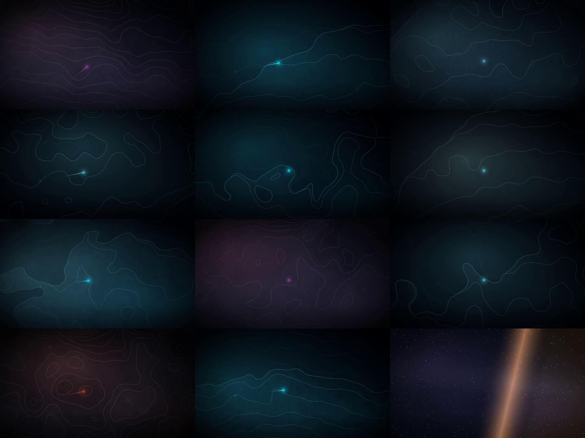

# Core Views as live wallpapers

The season is also twelve moving wallpapers. This is where they live, what
they are made of, and — first, because it matters more than the rest — what
they are **not**.

## They are not footage, and they are not the place

`views/catalog.json` says `planned` for all twelve views, and its four
rendition slots are `null`. The renderer that turns Copernicus Sentinel
imagery and Copernicus DEM elevation into a real flyover needs tile access; it
has one, `tools/render_views.py`, and it has not published a frame yet.

So each loop is a **designed wallpaper built from the view's own plan**:

| Layer | Where it comes from |
|---|---|
| Accent and hour | the view's `scene` and `timeOfDay`, through the suite palette |
| Contour hairlines | noise seeded from the view's id — drawn, never traced from real geography |
| Shoreline | a curved waterline for the coastal scenes; the sea is darker and its own survey is fainter |
| The moving light | the camera's **real track**, from `views/catalog.json` through `views_geo.camera_at` |
| Calm bottom quarter | the launcher's cards sit there, so the frame goes quiet |
| Poster frame | frame 1 s in, 480×270, bundled in the APK |

The comet travels the same path the render will fly, at the same speed, so the
wallpaper is honest about the *move* even while it is honest that the *place*
is not photographed. When a view's 1080p rendition lands and is published, it
replaces that loop's MP4 and nothing else moves.

Three things keep this from turning into a false claim:

1. `views/catalog.json` keeps every `renditions` value `null` and every
   `status` `planned`, and `tests/test_coreviews_wallpapers.py` fails if that
   changes without a deliberate edit.
2. The generator's docstring and `CoreViewsLoop.kt` both say the art is drawn.
3. Nothing here enters the Motion feed, the Overflight feed or the Aerial
   Views feed. Those publish renders; this is what the icon pack plays.



*One frame from each loop, in season order — Three Sisters, Hawkesbury,
Wattamolla, Hyams Beach, Lord Howe, Wineglass Bay, Twelve Apostles, Uluru,
Whitehaven, Kati Thanda, Ningaloo, Terminator. Contour art, a coastline, a
travelling light on the camera's real track. Not a photograph of any of them.*

## Where the loops live

```
Motion/live/coreviews-live-01-three-sisters.mp4       1920×1080 · 30 fps · 20 s · silent
Motion/live/thumbs/coreviews-live-01-three-sisters.jpg poster, for the live feed and the repo
app/src/main/assets/coreviews_thumbs/…jpg              the copy the APK bundles
```

They share `Motion/live/` with the Motion line on purpose: one folder is what
`Loop.url` builds from, and a second media folder would be a second base URL
to keep correct. `npm`-style naming keeps them apart —
`coreviews-live-NN-slug.mp4` vs `coremotion-live-NN-set-slug.mp4`.

The ids are `coreviews-<slug>`, and they are **never renamed**: the id is the
value stored in `Prefs.liveLoopId`, so renaming one silently re-points an
installed wallpaper at the shipped default.

## In the app

`LiveLoop.LOOPS` is the Motion line's forty-eight loops followed by
`CoreViewsLoop.LOOPS`. One list, because the engine, the rotation
(`LoopRotation`), the downloader's cache sweep and the browser grid all read
it — and because the Motion set has to stay first: `byId` falls back to
`LOOPS[0]`, which is the shipped default for a preference this build does not
recognise. A Core Views loop ahead of it would move that default.

Everything else is inherited, deliberately:

- the browser appends them through `LiveLoop.asWallpapers()`, so they appear
  under the **Live** chip with the LIVE badge and share the grid, the D-pad
  chain and the preview screen;
- Set live downloads the MP4, writes the preference and hands the user to the
  system picker (`LiveWallpaperService` is the picker's target, not ours);
- before the MP4 lands the engine draws the bundled poster frame, so the home
  screen is never blank;
- the engine stays muted, loops, and pauses off-screen.

## Watch them without a TV

[`core-views-wallpapers-preview.html`](core-views-wallpapers-preview.html) is
the season as one self-contained page: a 16:9 stage with a launcher's clock and
app row over it, all twelve loops, and the caption track. No network, no video
codec — each view's canvas is embedded as a JPEG data URI and the motion (the
parallax crop, the light travelling the camera's track, the terminator sweep on
the archive view) is drawn live in the page from the same numbers the MP4s are
rendered from.

`1`–`0` jump to a view, `←` `→` step, `space` pauses, `h` hides the launcher so
you can see the wallpaper bare. Generated by
`tools/build_coreviews_wallpapers_html.py`, checked in CI.

## Generating

```bash
pip install numpy pillow imageio-ffmpeg

python tools/coreviews_roster.py                       # list the season
python tools/build_coreviews_loops.py --palette        # one PNG per view, no ffmpeg
python tools/build_coreviews_loops.py                  # twelve loops, ~5 min
python tools/build_coreviews_kt.py                     # CoreViewsLoop.kt + revisions
python tools/build_coreviews_wallpapers_html.py        # the example page
python tools/build_coreviews_kt.py --check             # CI
```

`--palette` exists because a wallpaper is a look, and the only way to judge a
look is to see it: it writes one full-size still per view to
`build/coreviews-palette/` and needs no video encoder.

Both generators are deterministic — same catalogue, same seed, same clip — so
`--check` is meaningful rather than decorative.

## What the format is, and why

| Property | Value | Why |
|---|---|---|
| Size / rate | 1920×1080, 30 fps | the engine's and the other loops' shape; 60 fps buys nothing on contour art and doubles the download |
| Length | 20 s | one camera move, and the same length as every Motion loop |
| Audio | none | a wallpaper that makes noise is a defect |
| Container | H.264 High, `yuv420p`, `+faststart` | fetched and played while it arrives |
| Seam | frame N == frame 0 | the parallax crop runs whole cycles, and the travelling light fades out at the end of its track and in at the start |
| Bottom 25 % | quiet | launchers put cards there |

The seam rule needs the fade: a camera track is not a closed curve, so running
the light the whole way along it and letting it snap back is a jump cut. It
fades to nothing at the end of the track and comes back at the start, which
hides the wrap and keeps frame N equal to frame 0.

## Checks

`tests/test_coreviews_wallpapers.py` (CI: `suite-ci.yml`) holds:

- the roster, the Kotlin list and `views/catalog.json` to one list, in order;
- every loop's MP4, poster and bundled frame, and the hash in Kotlin to the
  committed file;
- 1080p / 30 fps / 20 s / silent / faststart;
- `MOTION_LOOPS + CoreViewsLoop.LOOPS`, with Motion first;
- the catalogue still `planned`, and the docs still saying so.
