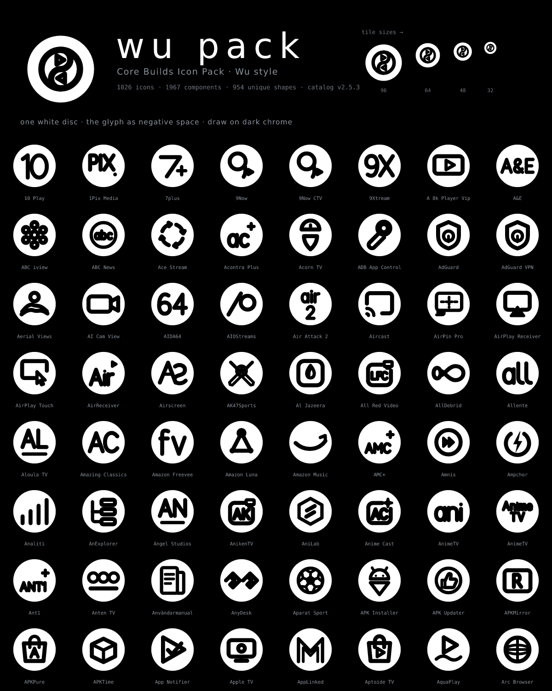
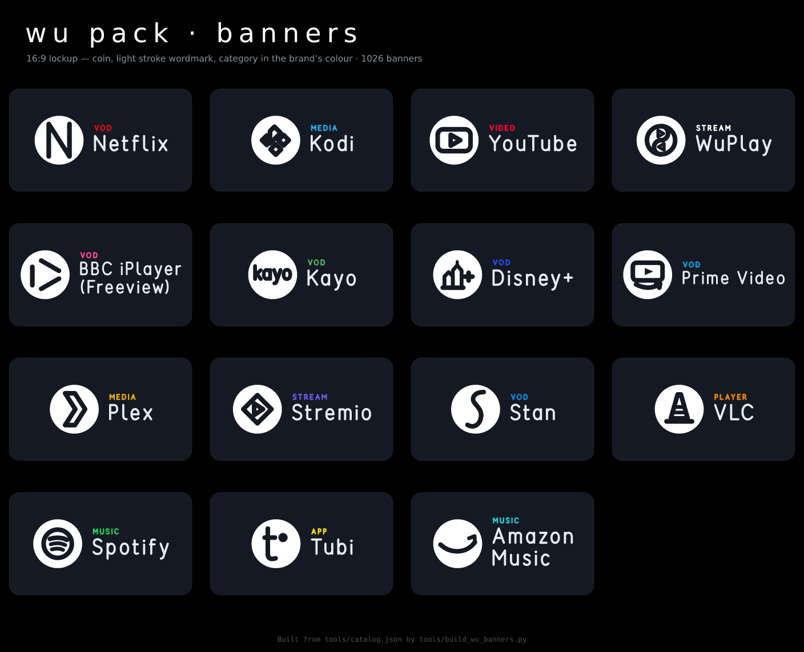

# Core Builds Wu Pack

**One white disc, the glyph as negative space.** A monochrome style variant of
the [Core Builds Icon Pack](../README.md), built after the WuPlay mark: pure
white ink, no accent hues, a circular container and the recognisable cue cut
out of it as negative space — the way WuPlay's dark play wedge sits inside its
white lobe. Same catalog, same glyphs, same component mappings; only the style
language changes. Ships both arts: square coins **and 16:9 banners** in the
same lockup WuPlay uses — mark left, wordmark right — with each app's brand
colour kept as the one thread on the card.

<div align="center">
<br><sub>First page — the full 1022-icon sheet: <a href="preview.png">preview.png</a></sub></div>

<div align="center">
<br><sub>16:9 banners on Projectivy-style cards</sub></div>

## Style rules

| Rule | Value |
|---|---|
| Ink | `#FFFFFF` only — hue is not part of this style (mask luminance would half-open a dark stroke anyway) |
| Ground | Transparent — draw on dark chrome (`#000000`, `#0D1117`) |
| Disc | `r=211` on the 512 grid, so the +5px night keyline lands exactly on the Classic safe area (40px margin) |
| Cut | The glyph is knocked out of the disc by a luminance mask — holes are transparent |
| Rim gap | ≥ 20px: every glyph is optically scaled to a 191px ink radius, so nothing breaks the edge and the family reads at one size |
| Weight | Primary 40 · detail 32.8 / 27.2 (0.82 / 0.68), constant pack-wide — bolder than Classic's 32 because the disc carries mass the way the WuPlay mark does |
| Keyline | The same presence pass Classic ships: a night ring keeps the white disc defined on a bright wallpaper |
| Geometry | Unchanged — the catalog's glyphs, the committed Classic fit, nothing redrawn |

A circle crops a square, so the bbox-corner fit is deliberately conservative:
wide wordmarks fill the disc, square constructions sit inset like engraving.
Both were tuned at tile size — the contact sheet's size ladder (96/64/48/32)
is the proof.

## Banners (16:9)

Banners reuse Classic's composition grammar — same 320×180 canvas (1280×720
master), same measured ink budget, same name fit solver and two-line break,
same centring audit — with the Wu lockup:

| Rule | Value |
|---|---|
| Mark | The Wu coin, scaled on the same 416-grid box as Classic's glyph cap |
| Wordmark | The pack's stroke letters at **0.15×cap weight, 0.42 cap tracking** (Classic: 0.19 / 0.30) — the lighter, open WuPlay wordmark — in Brand Guide ink `#E6EDF3` |
| Brand thread | The category kicker (VOD, STREAM, …) keeps each app's **brand accent** — the one colour on the card, and what Monet reads off it |
| Names | Each app's own name (plus `banner_name` / `banner_glyph` / glyph-only overrides) — banners separate what monochrome squares cannot: 13 IPTV players share one coin, never one name |
| Keyline | None — banners ship without the presence pass, exactly like Classic's |

Mappings: `appfilter-banners.xml` is derived from this pack's square
appfilter with the same `_banner` suffix rule as `build_banners_pack.py`,
and holds the same 1950 entries as the shipped pack's banner appfilter.

## What is reused, what is not touched

- **Source of truth:** `tools/catalog.json` — 1022 icons, exactly what
  Classic builds from. The generator never edits it.
- **Mappings:** `appfilter.xml` and `drawable.xml` are copied from the glyph
  companion's generated XML (`glyphs/src/main/res/xml/`), so the Wu pack and
  the shipped pack map the same 1950 component entries and cannot drift.
  Only the fallback furniture (`iconback` / `iconmask` / `iconupon`) is
  dropped — those drawables live in the Classic app; the `scale` line stays.
- **Classic pack: untouched.** Its validators forbid fills, containers and
  non-accent ink, and the suite keeps one shipped icon pack. This folder is
  generated art and mappings — no APK, no `suite.json` row. If it ever
  graduates to a companion package, it would follow the `glyphs/`
  companion pattern and needs that decision first.
- **Known lookalikes:** once hue is dropped, 40 shape groups (112 icons —
  the 13 IPTV players on one glyph, the file managers on `folder`, …) share
  art. Accents separated them in Classic; here the browser tile repeats.
  The mapping is unaffected, the banners tell them apart by name, and the
  build prints the groups every run.
- **Owner alternates stay Classic-only.** Catalog `alternates`
  (owner-supplied raster tiles such as `wuplay_alt`) never enter an
  appfilter and never wear a style — the Wu browsers list drawn Wu art
  only, and the generators drop them when copying the companion XML.

## Layout

```
wu-pack/
├── svg/                 1022 square masters (mask knockout, 512)
├── banners/             1022 banner masters (Wu lockup, 1280×720)
├── webp/                squares + <d>_banner tiles; dup renders ship once
├── values/aliases.xml   square dup renders → canonical art
├── values/banner_aliases.xml
├── appfilter.xml         component → disc (copied from the glyph companion)
├── appfilter-banners.xml component → <d>_banner (same 1950 entries as shipped)
├── drawable.xml          icon browser grid, Wu categories
├── drawable-banners.xml  banner browser grid, Wu Banners sections
├── preview.png          contact sheet on pure black (all 1022, header + ladder)
├── preview-hero.png     first page, for README embeds
├── preview-banners.png  banner card mockups
├── preview.svg / preview-banners.svg
└── README.md
```

## Build

```bash
python3 -m venv .venv                    # gitignored, the repo convention
.venv/bin/pip install -r tools/requirements.txt
.venv/bin/python tools/build_wu_pack.py            # squares: SVG + WebP + XML + sheet
.venv/bin/python tools/build_wu_banners.py         # banners (after build_wu_pack.py)
.venv/bin/python tools/build_wu_pack.py --svg-only # masters + XML + sheet, no raster
```

Both generators run the Classic catalog validation first (same gate
`tools/build_icons.py` uses), then print receipts for everything they wrote.
Gate: `python3 tests/test_wu_pack.py` (stdlib only — style constants,
monochrome masters, mapping parity with both shipped appfilters, art
resolution, sheet coverage).

Never hand-edit this folder — regenerate.
